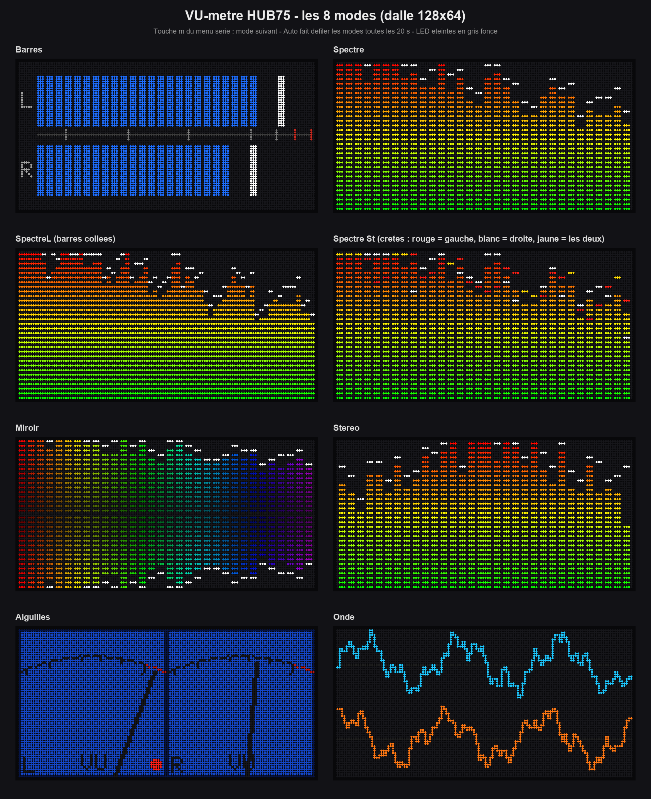

# VU-mètre ESP32 HUB75

VU-mètre stéréo autonome (sans wifi) sur ESP32 et panneau(x) LED HUB75.



*Aperçu simulé sur une dalle 128x64 (généré par `docs/rendu.py`) ; les points gris figurent les LED éteintes.*

- Entrée ligne analogique : GPIO36 (L) / GPIO39 (R), polarisée ~1,3 V, lue par l'ADC interne via I2S0.
- Panneau sur I2S1 (mêmes broches que l'horloge ClockV1).
- Dispositions : 64x64, 2x64x64, 128x64, 2x128x64.
- Modes d'affichage : Barres (VU horizontal bleu), Spectre, SpectreL (barres collées), Spectre St (crêtes gauche rouge / droite blanche, jaune si égales), Miroir, Stéréo, Aiguilles (cadrans bleus), Onde, et Auto qui les fait défiler toutes les 20 s.
- Mode démo : cavalier permanent entre GPIO18 et la masse, ou touche `d` du menu série → musique synthétisée en interne (batterie, basse, arpège stéréo), sans source audio. Se met ou s'enlève à chaud.

## Menu du moniteur série

Moniteur série à **115200 bauds** : le menu s'affiche au démarrage, puis avec `?`. Taper la touche puis Entrée.

```
===== VU-metre v1.35 =====
Dalle : 128x64   Mode : Auto   Luminosite : 3/5
Demo  : arretee
-------------------------------
  1 : dalle 64x64
  2 : dalle 2x64x64
  3 : dalle 128x64  <- actuelle
  4 : dalle 2x128x64
  d : demo marche / arret
  m : mode d'affichage suivant
  l : luminosite suivante
  ? : afficher ce menu
```

- `1` à `4` : choix de la dalle, enregistré, l'ESP32 redémarre.
- `d` : lance ou arrête la démo, choix mémorisé après redémarrage (le cavalier GPIO18 force la démo quel que soit ce réglage).

Détails, outils pour se connecter et exemples : [docs/menu-serie.md](docs/menu-serie.md).

Câblage : [docs/branchement.png](docs/branchement.png) (généré par `docs/branchement.py`).

Compilation : `./build.ps1` (arduino-cli, ESP32 classique) → `vumeter.bin`.

> Pas encore testé sur le matériel.

## Firmware

Binaire prêt à flasher (un seul binaire pour toutes les dalles, à l'adresse 0x10000) :
[firmware/vumeter_v1.35.bin](firmware/vumeter_v1.35.bin) — MD5 `a341b4e402c5e385cf15d3c8d65f6d9c`
